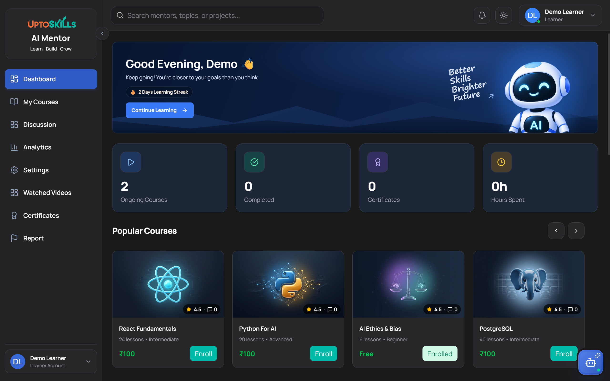
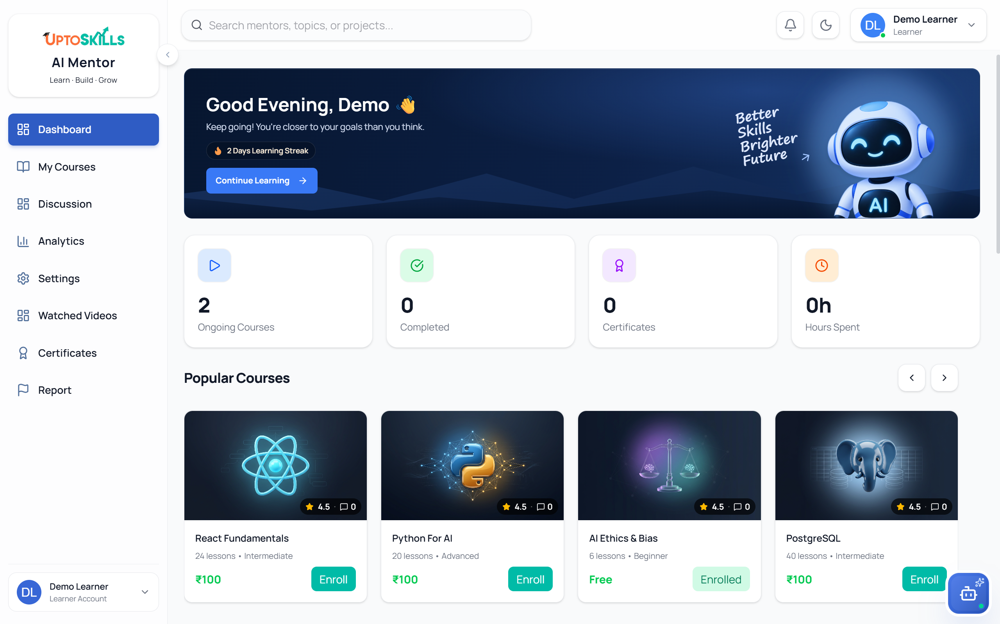

<div align="center">
  

  <h1>AI Mentor</h1>

  <p><strong>Learn smarter · Manage better · Build with AI</strong></p>

  <p>
    A multi-service learning platform for learners and administrators, combining course discovery,
    AI-assisted lessons, analytics, community discussions, payments, and platform management.
  </p>

  <p>
    <a href="#quick-start"><strong>Quick Start</strong></a> ·
    <a href="#architecture"><strong>Architecture</strong></a> ·
    <a href="#documentation"><strong>Documentation</strong></a> ·
    <a href="#contributing"><strong>Contributing</strong></a>
  </p>

  <p>
    <a href="https://github.com/Deepak3699/Ai_Mentor/actions/workflows/ci.yml"></a>
    <a href="https://github.com/Deepak3699/Ai_Mentor/actions/workflows/code-review.yml"></a>
    <a href="https://nodejs.org/"></a>
    <a href="https://react.dev/"></a>
    <a href="https://www.python.org/"></a>
    <a href="https://prettier.io/"></a>
  </p>
</div>

<p align="center">
  
  
</p>

## Table of contents

- [Platform overview](#platform-overview)
- [Key capabilities](#key-capabilities)
- [Architecture](#architecture)
- [Applications and local ports](#applications-and-local-ports)
- [Technology stack](#technology-stack)
- [Repository structure](#repository-structure)
- [Prerequisites](#prerequisites)
- [Quick start](#quick-start)
- [Environment configuration](#environment-configuration)
- [Development commands](#development-commands)
- [Quality and validation](#quality-and-validation)
- [Continuous integration](#continuous-integration)
- [Security](#security)
- [Documentation](#documentation)
- [Contributing](#contributing)
- [Project context](#project-context)

## Platform overview

AI Mentor is organized as five cooperating services:

1. The learner web application provides authentication, courses, AI lessons, analytics, discussions, settings, and purchasing workflows.
2. The user API manages authentication, user data, courses, payments, community features, analytics, notifications, and communication with the AI service.
3. The administrator web application provides management interfaces for courses, users, enrollments, payments, reports, notifications, and platform analytics.
4. The administrator API provides protected administrative and super-administrator operations over the shared platform data.
5. The Python AI service generates lesson content, audio, video, transcripts, and AI-generated course syllabi.

The user and administrator APIs share the same PostgreSQL database. The Node.js user API acts as the application-facing bridge to the Python AI service.

## Key capabilities

### Learner experience

- Email/password authentication and Firebase Google sign-in
- Password recovery and account management
- Course catalog, previews, purchases, and enrolled-course access
- AI-generated lesson videos with job-status polling and transcript access
- Learning analytics and watched-video history
- Community discussions, reports, and notifications
- Theme preferences and multilingual interface support
- Stripe and Razorpay integration points for course payments

### Administration

- Administrator and super-administrator authentication
- Course creation, publication state management, enrollment views, and AI syllabus generation
- User account status, blocking, and deletion controls
- Enrollment and payment reporting
- Community moderation and report handling
- Administrative notifications, profile settings, and dashboard analytics
- Export-oriented frontend dependencies for spreadsheet, CSV, and PDF workflows

### AI lesson service

- Gemini-based lesson and syllabus generation
- Optional Groq fallback for syllabus generation
- Text-to-speech generation
- FFmpeg video composition
- Optional Cloudinary delivery with local-storage fallback
- FastAPI endpoints for generation, status, transcripts, streaming, and syllabus creation

## Architecture

```text
Learner browser (:5173) ──> User API (:5000) ───────┐
                                                     ├──> PostgreSQL
Admin browser (:5174) ───> Admin API (:5001) ───────┘
                                  │
User API / Admin API ─────────────┴──> AI service (:8000)
                                          │
                         Gemini / Groq / TTS / FFmpeg
                                          │
                              Cloudinary or local output
```

The root development runner coordinates all five local services. It starts frontends only after their matching APIs are healthy, starts or reuses the Python AI service, and stops only processes started by the current terminal.

## Applications and local ports

| Application | Directory             | Local URL               | Purpose                                |
| ----------- | --------------------- | ----------------------- | -------------------------------------- |
| Learner web | `frontend/`           | `http://localhost:5173` | Learner-facing React application       |
| User API    | `backend/`            | `http://localhost:5000` | Main Express API and AI-service proxy  |
| Admin web   | `frontendAdmin/`      | `http://localhost:5174` | Administrative React application       |
| Admin API   | `backendAdmin/`       | `http://localhost:5001` | Protected management API               |
| AI service  | `ai_service/backend/` | `http://localhost:8000` | FastAPI AI lesson and syllabus service |

## Technology stack

| Area                      | Technologies                                                                            |
| ------------------------- | --------------------------------------------------------------------------------------- |
| Learner frontend          | React 19, Vite 7, Tailwind CSS 4, React Router, Axios, Firebase, i18next, Recharts      |
| Admin frontend            | React 19, Vite 7, Tailwind CSS 4, React Router, Axios, Vitest                           |
| User API                  | Node.js, Express 5, Sequelize 6, PostgreSQL, JWT, Firebase Admin, Zod                   |
| Admin API                 | Node.js, Express 5, Sequelize 6, PostgreSQL, JWT, Zod                                   |
| AI service                | Python, FastAPI, Uvicorn, Gemini, Groq, text-to-speech, FFmpeg, Cloudinary              |
| Payments                  | Stripe and Razorpay integrations                                                        |
| Queues and infrastructure | BullMQ, Redis, Cloudinary, Neon-compatible PostgreSQL                                   |
| Quality tooling           | ESLint, Prettier 3.9.10, Husky, lint-staged, Vitest, Node test runner, pytest, gitleaks |

## Repository structure

```text
Ai_Mentor/
├── .github/                 GitHub templates and CI workflows
├── ai_service/              Python FastAPI AI generation service
├── backend/                 Learner-facing Node.js API
├── backendAdmin/            Administrative Node.js API
├── frontend/                Learner React application
├── frontendAdmin/           Administrator React application
├── scripts/                 Root dependency installer and development runner
├── CONTRIBUTING.md          Contribution and security workflow
├── initalSetup.md           First-time environment setup
├── package.json             Root commands and development tooling
└── README.md                Repository overview
```

## Prerequisites

Install the following before setting up the repository:

- Node.js 18 or newer. GitHub CI currently uses Node.js 20.
- npm
- Python 3.10 or newer. GitHub CI currently uses Python 3.11.
- PostgreSQL, or a hosted PostgreSQL provider such as Neon
- Redis for queue-backed backend functionality
- FFmpeg for AI video generation
- Git

## Quick start

### 1. Clone and configure

Clone the repository, then copy each required `.env.example` file to `.env`. Use [`initalSetup.md`](./initalSetup.md) for the complete variable list. Never commit `.env` files or credentials.

### 2. Install the complete project

```bash
npm run setup
```

The complete setup command:

- installs dependencies for the root workspace and all four Node/React applications;
- creates or reuses `ai_service/.venv`;
- installs `ai_service/backend/requirements.txt`;
- verifies Node.js, npm, Python, FFmpeg, AI configuration names, AI imports, and Redis/Memurai availability;
- does not create, overwrite, or print secrets from `.env` files.

To prepare only the AI service, use:

```bash
npm run setup:ai
```

### 3. Start development

```bash
npm run dev
```

This starts or reuses all five services: User API, learner web, Admin API, admin web, and AI API.

To start only the AI service, use:

```bash
npm run dev:ai
```

The runner labels AI output with `[AI/API]` and reports AI `Startup` and `Health` timing in the terminal dashboard. `Ctrl+C` stops only processes started by that terminal.

## Unified setup and development workflow

| Command            | Purpose                                                 |
| ------------------ | ------------------------------------------------------- |
| `npm run setup`    | Install and validate the complete project, including AI |
| `npm run setup:ai` | Create/reuse and validate only the AI environment       |
| `npm run dev`      | Start or reuse all five services                        |
| `npm run dev:ai`   | Start or reuse only the AI service                      |

## Environment configuration

The following table summarizes the main variable groups. Use the committed `.env.example` files as the source of truth.

| Service               | Main configuration groups                                                                                                                    |
| --------------------- | -------------------------------------------------------------------------------------------------------------------------------------------- |
| `backend/`            | Server port, JWT, PostgreSQL TLS/pool, AI service, frontend URL, SMTP, Firebase Admin, Cloudinary, Stripe, Razorpay, super-admin seed values |
| `backendAdmin/`       | Server port, admin frontend URL, JWT, shared PostgreSQL connection, TLS, optional local database values, super-admin seed values             |
| `frontend/`           | User API URL, Firebase web configuration, Stripe publishable key, Razorpay key ID                                                            |
| `frontendAdmin/`      | Admin API base URL                                                                                                                           |
| `ai_service/backend/` | Gemini and model, optional Groq fallback, optional Cloudinary storage, D-ID configuration                                                    |

Both Node.js APIs must point to the same PostgreSQL database. For production database connections, follow the TLS requirements documented in the environment templates.

Required AI configuration is `ai_service/backend/.env` with a real `GEMINI_API_KEY`. Groq, Cloudinary, and D-ID are optional. Missing required configuration stops setup with a clear error; missing optional configuration disables that provider or uses the supported fallback. Redis/Memurai is required for queued video generation, and FFmpeg is required for local video rendering.

## Development commands

Run root commands from the repository root.

| Command                      | Purpose                                                            |
| ---------------------------- | ------------------------------------------------------------------ |
| `npm run setup`              | Install and validate all Node/React and AI dependencies            |
| `npm run setup:ai`           | Create/reuse and validate only the AI environment                  |
| `npm run dev`                | Start or reuse User, Admin, and AI services                        |
| `npm run dev:ai`             | Start or reuse only the AI service                                 |
| `npm run dev:user`           | Start the user API and learner web application                     |
| `npm run dev:admin`          | Start the admin API and admin web application                      |
| `npm run dev:backend`        | Start only the user API                                            |
| `npm run dev:frontend`       | Start only the learner web application after checking the user API |
| `npm run dev:backend-admin`  | Start only the admin API                                           |
| `npm run dev:frontend-admin` | Start only the admin web application after checking the admin API  |
| `npm run lint`               | Run ESLint across all four JavaScript services                     |
| `npm test`                   | Run the repository's service test commands                         |
| `npm run format`             | Format supported repository files with the pinned Prettier version |
| `npm run format:check`       | Check formatting without modifying files                           |

Useful service-level commands include:

```bash
npm run lint --prefix backend
npm run test --prefix backend
npm run build --prefix frontend
npm run lint --prefix backendAdmin
npm run test --prefix backendAdmin
npm run build --prefix frontendAdmin
```

From `ai_service/`, run Python tests with:

```bash
python -m pytest
```

## Quality and validation

Before opening a pull request:

1. Format changed supported files with `npm run format`.
2. Verify formatting with `npm run format:check`.
3. Run `npm run lint`.
4. Run focused tests for the services and behavior changed.
5. Build a changed frontend with its service-level build command.
6. Confirm no environment files, credentials, generated media, uploads, or build output are staged.

Prettier is pinned in the root package and uses the repository configuration in `.prettierrc.json`. Dependencies, builds, coverage, runtime uploads, environment files, caches, and generated media are excluded through `.prettierignore`.

## Continuous integration

GitHub Actions runs on pull requests targeting `main` or `dev`, and on pushes to `main`. The CI workflow includes:

- Repository-wide Prettier formatting verification
- User API linting and tests
- Learner frontend linting, tests, and production build
- Admin API linting and tests
- Admin frontend linting, tests, and production build
- Python AI-service syntax, dependency, and pytest checks
- Full-history and content secret scanning with gitleaks
- A separate Reviewdog ESLint workflow for pull requests

CI uses dummy frontend and AI-service values where configuration is required only to validate builds or tests. Real credentials must not be committed.

## Security

- Never commit `.env` files, API keys, tokens, passwords, private keys, or webhook secrets.
- GitHub CI rejects tracked `.env` files and scans repository history and content with gitleaks.
- If a real secret is exposed, rotate it at the provider before removing it from Git history.
- Use narrowly scoped, reviewed exceptions only for confirmed false positives.
- Keep production PostgreSQL certificate verification enabled.
- Use long, random JWT secrets and protect super-administrator credentials.
- Review [`CONTRIBUTING.md`](./CONTRIBUTING.md) before changing secret-scanning configuration.

## Documentation

- [`initalSetup.md`](./initalSetup.md): first-time environment and database setup
- [`CONTRIBUTING.md`](./CONTRIBUTING.md): branch, commit, validation, review, and security workflow
- [`backend/README.md`](./backend/README.md): user API setup and endpoints
- [`backend/BACKEND_DOCUMENTATION.md`](./backend/BACKEND_DOCUMENTATION.md): detailed backend reference
- [`frontend/README.md`](./frontend/README.md): learner application setup and routes
- [`backendAdmin/backendAdmin_Documentation.md`](./backendAdmin/backendAdmin_Documentation.md): admin API architecture and endpoints
- [`frontendAdmin/FRONTEND_ADMIN_DOCUMENTATION.md`](./frontendAdmin/FRONTEND_ADMIN_DOCUMENTATION.md): admin interface architecture
- [`ai_service/README.md`](./ai_service/README.md): AI pipeline, configuration, endpoints, and troubleshooting

## Contributing

Contributions should use a focused branch and pull request. Run the relevant formatter, linter, tests, and builds before pushing. Do not push directly to `main`, bundle unrelated changes, or merge another contributor's pull request without authorization.

See [`CONTRIBUTING.md`](./CONTRIBUTING.md) for the complete workflow, commit-message convention, secret-scanning process, and review requirements.

## Project context

AI Mentor was developed as part of an internship project. Rights remain with the respective authors and organization.
