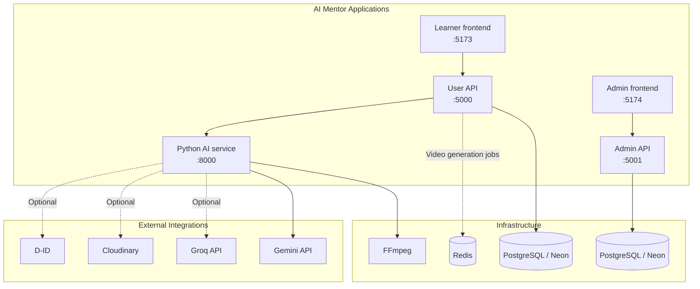

# Runtime Dependencies and Startup Order

Understand how the five AI Mentor applications work together before starting them. Follow this guide to learn what each application depends on and how to start them in the correct order.

## 0. Understanding the Runtime Dependencies

AI Mentor consists of five separate applications that work together to provide the full platform. Each application has its own requirements and connections to other services.

| Application | Folder | Default address | What it does |
|---|---|---|---|
| User API | `backend/` | `http://localhost:5000` | Handles learner accounts, courses, payments, and other learner-side requests |
| Learner frontend | `frontend/` | `http://localhost:5173` | The website learners use |
| Admin API | `backendAdmin/` | `http://localhost:5001` | Handles admin-side requests |
| Admin frontend | `frontendAdmin/` | `http://localhost:5174` | The website administrators use |
| Python AI service | `ai_service/backend/` | `http://127.0.0.1:8000` | Generates AI content and media |

The two frontends communicate with their matching APIs. Both APIs connect to PostgreSQL, while the User API also communicates with the Python AI service for AI-related features.

## 1. How the Applications Connect

The following diagram shows the main connections between the applications and the services they use.



The learner frontend communicates with the User API, while the admin frontend communicates with the Admin API.

Both APIs use PostgreSQL through Sequelize. However, their database configurations are separate, so check each API's environment configuration to confirm which database it connects to.

The User API also communicates with the Python AI service for AI-related features. Video generation uses Redis through BullMQ to manage background jobs.

### Main connections

- The learner frontend sends requests to the User API.
- The admin frontend sends requests to the Admin API.
- Both APIs use PostgreSQL through Sequelize. Their database configurations are separate.
- The User API uses Redis and BullMQ for queued video-generation work.
- The User API communicates with the Python AI service for AI-related features.
- The Python AI service uses Gemini for AI generation. Groq, Cloudinary, and D-ID are optional integrations.

## 2. External Services and Tools

Some applications need tools or services outside the repository. Make sure the required ones are available before using the related features.

| Dependency | Used by | Purpose |
|---|---|---|
| PostgreSQL / Neon | User API and Admin API | Stores application data through Sequelize. |
| Redis | User API | Used by BullMQ to manage video-generation jobs. |
| Python 3.10+ | AI service | Runs the Python-based AI application. |
| FFmpeg | AI service | Processes videos and combines generated audio with video. |
| FFprobe | AI service | Reads video metadata during processing. |
| Gemini API | AI service | Provides AI-powered content generation. |
| Groq | AI service | Optional AI provider integration. |
| Cloudinary | AI service | Optional cloud storage for generated media. |
| D-ID | AI service | Optional avatar video generation integration. |

**Important notes:**

- Redis is needed when the video-generation queue is used. The queue and worker are initialized when requested, not during normal User API startup.
- FFmpeg is checked when the Python AI service starts. FFprobe is used for video metadata but is not checked by that startup check.
- Set `GEMINI_API_KEY` for Gemini-powered generation.
- Groq, Cloudinary, and D-ID are optional integrations.


## 3. Startup Order

Before starting the applications, make sure the required external services and dependencies are available.

### 1. Prepare the dependencies

- Install Node.js and npm.
- Set up Python and install the AI service requirements.
- Configure the database connections for both APIs.
- Start Redis if you plan to use video generation.
- Install FFmpeg and make sure it is available in your system PATH.
- Configure the required environment variables.

### 2. Start the User API

From the repository root, run:

```bash
npm run dev:backend
```

The User API connects to its configured database and runs Sequelize model synchronization before listening on port `5000`.

### 3. Start the Admin API

Run:

```bash
npm run dev:backend-admin
```

The Admin API connects to its configured database and listens on port `5001`. It does not run Sequelize model synchronization during startup.

### 4. Start the Python AI service

Run:

```bash
npm run dev:ai
```

The root development runner launches the Python service through `graceful_server.py`. The service listens on `127.0.0.1:8000` after successful startup and checks for FFmpeg during its startup process.

### 5. Start the frontends

Start the learner frontend:

```bash
npm run dev:frontend
```

Start the admin frontend:

```bash
npm run dev:frontend-admin
```

These frontend-only commands check whether their matching API is available before starting the frontend.

**Note:** Starting the APIs before the frontends is recommended because the frontends need their respective APIs for application features. The combined development commands do not wait for API readiness before starting the frontends.


## 4. Using the Root Development Runner

The root development runner starts the applications selected by the command.

- `npm run dev` starts all five applications.
- `npm run dev:user` starts the User API and learner frontend.
- `npm run dev:admin` starts the Admin API and admin frontend.
- `npm run dev:backend` starts only the User API.
- `npm run dev:frontend` checks the User API before starting the learner frontend.
- `npm run dev:backend-admin` starts only the Admin API.
- `npm run dev:frontend-admin` checks the Admin API before starting the admin frontend.
- `npm run dev:ai` starts only the Python AI service.

For combined commands such as `npm run dev`, `npm run dev:user`, and `npm run dev:admin`, the selected applications are started without waiting for the APIs to become ready.

The frontend-only commands are different: they check the matching API before starting the frontend.

The runner also checks whether an application is already available and can reuse an existing service instead of starting another instance.

**Important:** The runner's availability check does not confirm that the database is ready. Use the API readiness endpoint to check database connectivity.

Press `Ctrl + C` to stop the processes started by that runner. Services that were already running before the runner started are not stopped by it.

## 5. Checking Whether the Services Are Ready

Use these addresses to check the applications:

| Application | Address |
|---|---|
| User API liveness | `http://localhost:5000/health/live` |
| User API readiness | `http://localhost:5000/health/ready` |
| Admin API liveness | `http://localhost:5001/health/live` |
| Admin API readiness | `http://localhost:5001/health/ready` |
| Learner frontend | `http://localhost:5173` |
| Admin frontend | `http://localhost:5174` |
| Python AI service | `http://127.0.0.1:8000/` |
| Python AI API docs | `http://127.0.0.1:8000/docs` |


### API health checks

Both APIs provide these endpoints:

| Endpoint | Meaning |
|---|---|
| `/health/live` | Confirms that the API process is running. |
| `/health/ready` | Checks whether the API can connect to its database. |

A successful `/health/ready` response returns HTTP `200`. If the database connection fails, it returns HTTP `503`.

The User API does not define a separate `/health` endpoint, so `/health` returns `404` for that API.

The Admin API also provides a separate `/health` endpoint that returns HTTP `200`.

Use `/health/ready` when you want to check database connectivity, rather than relying only on whether the API responds.

## 6. How Video Generation Uses These Dependencies

Video generation is a good example of why the services need to connect correctly.

1. The learner requests a video through the learner frontend.
2. The frontend sends the request to the User API.
3. The User API checks the request and saves the video record in PostgreSQL.
4. The User API adds a job to BullMQ, which uses Redis.
5. A BullMQ worker sends the generation request to the Python AI service.
6. The Python AI service generates the requested content and media.
7. The User API receives the generation status from the Python AI service and updates the video record in PostgreSQL when the worker receives the generation result.
8. The learner frontend gets the updated status through the User API.

This flow needs the User API, PostgreSQL, Redis, and Python AI service to be available. The Python service also needs its configured AI provider and the media tools required by the generation process.

The frontend communicates with the User API rather than sending video-generation requests directly to the Python service.


## 7. Before You Start Working

Use this checklist when setting up the project:

- [ ] Node.js and npm are installed.
- [ ] Python 3.10+ is installed.
- [ ] FFmpeg is installed and available in the terminal.
- [ ] PostgreSQL or Neon is configured for both APIs.
- [ ] Redis is running if you need video generation.
- [ ] The Python AI service environment is configured.
- [ ] The required Gemini API key is set.
- [ ] Dependencies are installed using the setup instructions.
- [ ] Check that both API database configurations point to the intended databases. Do not assume they automatically share the same database.
- [ ] If you use the combined development commands, remember that the frontends may start before their APIs are ready.

For installation steps and environment-variable setup, see [initalSetup.md](./initalSetup.md).

For details about contributing code, see [CONTRIBUTING.md](./CONTRIBUTING.md).
