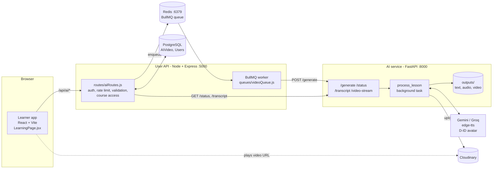
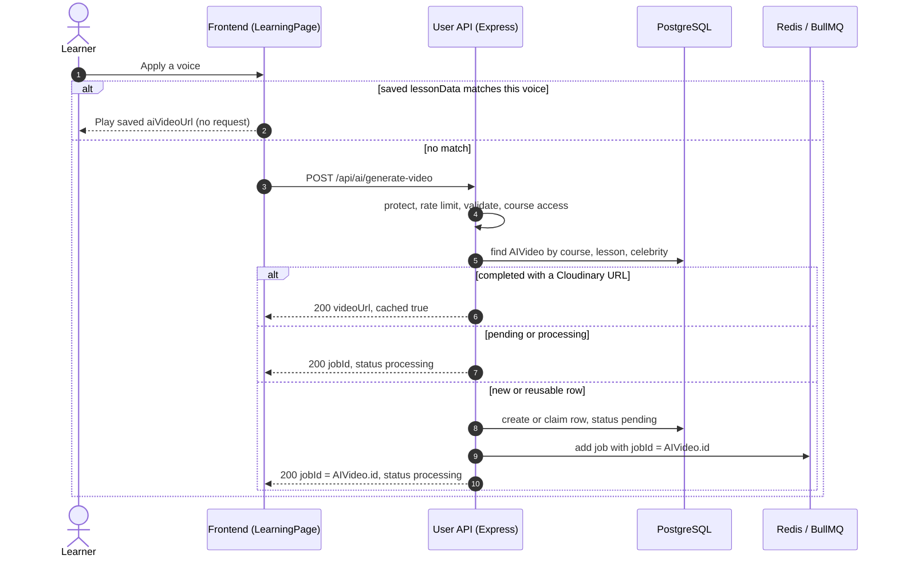
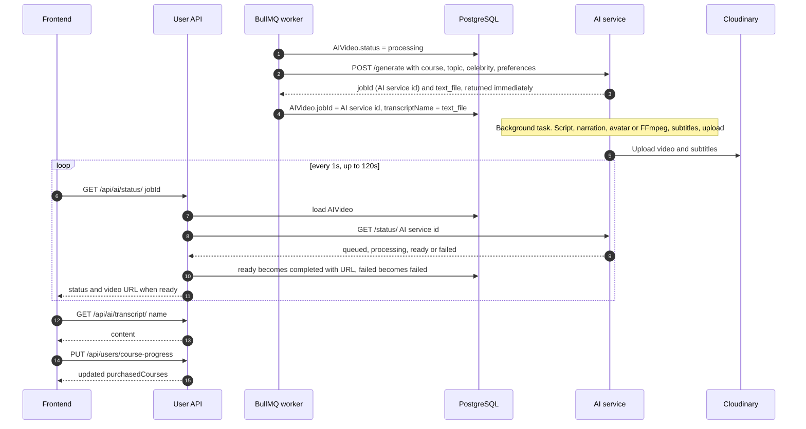
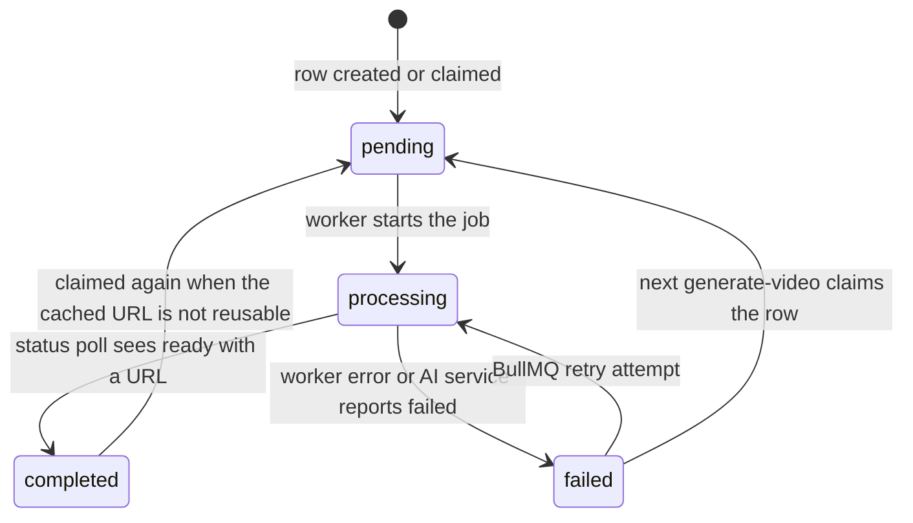
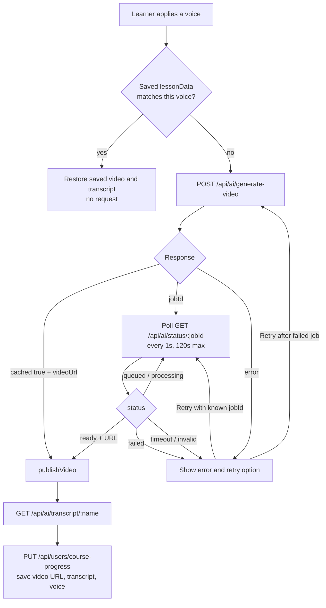

# Cross-Service Request Flow: AI Lesson Generation

## Contents

1. [Overview](#1-overview)
2. [Who owns what](#2-who-owns-what)
3. [Request lifecycle](#3-request-lifecycle)
4. [API contracts](#4-api-contracts)
5. [Data contracts and state](#5-data-contracts-and-state)
6. [Cache behavior](#6-cache-behavior)
7. [Generated media: storage and retrieval](#7-generated-media-storage-and-retrieval)
8. [Frontend behavior](#8-frontend-behavior)
9. [Supporting flow: authentication and course access](#9-supporting-flow-authentication-and-course-access)
10. [Configuration and runtime requirements](#10-configuration-and-runtime-requirements)
11. [Key files](#12-key-files)

---

## 1. Overview

When a learner opens a lesson and applies an AI voice the
platform produces a short narrated video plus a transcript for that lesson. The work is split
across three services and several stores:



Three ideas explain most of the design:

- **The generation is asynchronous at every layer.** The browser submits and then polls. The user
  API enqueues and returns immediately. The AI service returns a job ID immediately and works in
  a background task.
- **There are two job IDs.** The browser only ever sees `AIVideo.id` (a UUID owned by the user
  API). The AI service's own job ID (a filename-style string) is stored in `AIVideo.jobId` and
  never leaves the backend.
- **Results are cached per lesson and voice, not per user** (see [Cache behavior](#6-cache-behavior)).

---

## 2. Who owns what

| Concern                  | Owner                                        | Details                                                                                                                                                                                                                                |
| ------------------------ | -------------------------------------------- | -------------------------------------------------------------------------------------------------------------------------------------------------------------------------------------------------------------------------------------- |
| **Input validation**     | User API (shape) and AI service (limits)     | The user API validates with zod (`schemas/aiSchema.js`: `generateVideoSchema`). The AI service re-validates with pydantic (`LessonRequest`: length limits, `preferences` with `extra="forbid"`). The frontend only builds the payload. |
| **Authentication**       | User API                                     | JWT in the `Authorization: Bearer` header, checked by `protect` (`middleware/authMiddleware.js`). The AI service has **no auth** and is assumed to be reachable only from the user API.                                                |
| **Authorization**        | User API                                     | `hasCourseAccess` in `aiRoutes.js`: the course must be in `user.purchasedCourses`, or the user is `admin` / `superadmin`. Applied to generate, status, transcript and video routes.                                                    |
| **Rate limiting**        | User API                                     | `aiVideoLimiter`: 3 generations per 5 minutes per user.                                                                                                                                                                                |
| **Persistence**          | User API + PostgreSQL                        | `AIVideo` rows (job state, URL, transcript cache) and the learner's `purchasedCourses[].progress.lessonData`. The AI service keeps only in-memory job state and local files.                                                           |
| **Queueing**             | User API (BullMQ + Redis)                    | Covers only the submit hop. The AI service runs its own work with FastAPI `BackgroundTasks`.                                                                                                                                           |
| **Generation**           | AI service                                   | Script (Gemini, Groq fallback), narration (edge-tts), video (D-ID, FFmpeg fallback), subtitles.                                                                                                                                        |
| **Final media delivery** | Cloudinary (preferred) or the user API proxy | The video URL normally points straight at Cloudinary. If upload fails, the user API streams the file from the AI service via `/api/ai/video/...`.                                                                                      |

---

## 3. Request lifecycle

### 3.1 Submit



### 3.2 Generate, poll, finish



### 3.3 Step by step

| #   | Step                        | Where                                                 | Notes                                                                                                                                                                  |
| --- | --------------------------- | ----------------------------------------------------- | ---------------------------------------------------------------------------------------------------------------------------------------------------------------------- |
| 1   | Learner applies a voice     | `LearningPage.jsx`, `VoiceoverDialog` `onApply`       | Sets `selectedCelebrity`, which triggers the generation effect.                                                                                                        |
| 2   | Saved content short-circuit | Effect in `LearningPage.jsx`                          | If `lessonData[lessonId].celebrity` equals the selection and an `aiVideoUrl` exists, no request is made.                                                               |
| 3   | Submit                      | `getAIVideo` in `service/aiService.js`                | `POST /api/ai/generate-video`. Celebrity is sent as the first word, lowercased (`"Salman Khan"` becomes `"salman"`). 30 s deadline.                                    |
| 4   | Gate                        | `router.post("/generate-video")`                      | `protect` then `aiVideoLimiter` then `validate(generateVideoSchema)` then `hasCourseAccess`.                                                                           |
| 5   | Dedupe and record           | Same handler                                          | Finds or creates the `AIVideo` row (unique on course, lesson, celebrity). See [Cache behavior](#6-cache-behavior).                                                     |
| 6   | Look up titles              | `getCourseAndLessonTitles`                            | Course and lesson titles become the AI service's `course` and `topic`. `404` if invalid.                                                                               |
| 7   | Load preferences            | `Preferences.findOne`                                 | The requesting user's saved learning preferences (if any) travel with the job.                                                                                         |
| 8   | Enqueue                     | `getVideoQueue().add("generate-video", ...)`          | `jobId = AIVideo.id`. Retries: 3 attempts, exponential backoff from 5 s.                                                                                               |
| 9   | Worker kicks off generation | `processVideoJob` in `queues/videoQueue.js`           | Sets `processing`, calls AI `POST /generate`, stores the AI service's `jobId` and `text_file`. The worker finishes as soon as the AI service acknowledges.             |
| 10  | AI pipeline                 | `process_lesson` in `ai_service/backend/api.py`       | Script (about 50 words) then edge-tts MP3, then D-ID avatar (or FFmpeg with a stock celebrity video), then VTT/SRT, then Cloudinary upload, then `job_status = ready`. |
| 11  | Poll                        | `pollAIVideoStatus` and `GET /api/ai/status/:jobId`   | Express answers from the DB where it can, and proxies the AI service otherwise. See the status table in section 4.2.                                                   |
| 12  | Publish                     | `publishVideo` in `LearningPage.jsx`                  | Sets the video URL, starts playback, loads the transcript.                                                                                                             |
| 13  | Transcript                  | `fetchTranscript` and `GET /api/ai/transcript/:name`  | Express serves its DB copy or fetches from the AI service and caches it.                                                                                               |
| 14  | Persist for next visit      | `saveLessonData` and `PUT /api/users/course-progress` | Stores `{generatedTextContent, aiVideoUrl, celebrity}` under the lesson. See caveat 5.                                                                                 |

---

## 4. API contracts

All user API errors use the envelope
`{ "success": false, "error": { "code": "...", "message": "...", "details": [] } }`,
except the rate limiter (see 4.1).

### 4.1 Frontend to user API

All routes are mounted at `/api/ai` and require `Authorization: Bearer <jwt>`. In development
Vite proxies `/api` to `VITE_API_BASE_URL`.

#### `POST /api/ai/generate-video`

Request:

```json
{ "courseId": 12, "lessonId": 87, "celebrity": "salman" }
```

`courseId` and `lessonId` accept positive integers or numeric strings. Optional `voice_id`,
`speech_rate` and `speech_pitch` (strings) are accepted but the frontend does not send them and
the worker does not forward them (caveat 7). `celebrity` is only checked to be non-empty here; the
AI service restricts it to `modi`, `owl`, `salman`, `srk` and falls back to `modi`.

Responses:

| Status | Body                                                                    | Meaning                                                        |
| ------ | ----------------------------------------------------------------------- | -------------------------------------------------------------- |
| 200    | `{ "jobId": "<AIVideo.id>", "status": "processing", "message": "..." }` | Queued, or already in progress. Start polling.                 |
| 200    | `{ "videoUrl", "transcriptName", "jobId", "meta", "cached": true }`     | Reusable video exists. No polling needed.                      |
| 400    | `VALIDATION_ERROR`                                                      | Body failed zod validation.                                    |
| 401    | `UNAUTHORIZED`                                                          | Missing or invalid token.                                      |
| 403    | `FORBIDDEN` "Course not purchased"                                      | No access to the course.                                       |
| 404    | `NOT_FOUND` "Invalid course or lesson"                                  |                                                                |
| 409    | `CONFLICT`                                                              | Row state changed during claim. Retry.                         |
| 429    | `{ "success": false, "error": "<message string>" }`                     | Rate limit (3 per 5 min). Note `error` is a plain string here. |
| 500    | `INTERNAL_SERVER_ERROR`                                                 |                                                                |

The frontend requires `cached === true` with a valid `videoUrl`, **or** a non-empty string `jobId`.
Anything else is treated as `invalid_response`.

#### `GET /api/ai/status/:jobId`

`:jobId` is the `AIVideo.id` returned above. Responses are chosen like this:

| Condition (DB, then AI service)         | Response                                                                                          |
| --------------------------------------- | ------------------------------------------------------------------------------------------------- |
| Row not found                           | `404`                                                                                             |
| No course access                        | `403`                                                                                             |
| `status = failed`                       | `{ "status": "failed", "error": "<message>" }`                                                    |
| `status = completed` and has URL        | `{ "status": "ready", "cloudinary_url": "<stored videoUrl>", "transcriptName", "jobId", "meta" }` |
| `status = pending`                      | `{ "status": "processing", "message": "In queue..." }`                                            |
| `status = processing`, no AI job ID yet | `{ "status": "processing", "message": "Starting..." }`                                            |
| `status = processing`, AI job ID known  | Proxies AI `GET /status/<aiJobId>`, see below                                                     |

When proxying, Express forwards the AI service's JSON and adds `jobId` (the DB id) and
`transcript_name`. If the AI service reports `ready` with a URL, Express also updates the row to
`completed` (`videoUrl`, `meta`, `transcriptName`). If it reports `failed`, the row becomes
`failed`. If the AI service call is not OK, Express answers `{ "status": "processing" }`.

For a local (non-Cloudinary) video, Express rewrites `local_video_url` to
`/api/ai/video/<courseId>/<AIVideo.id>.mp4`.

The frontend accepts `status` of `queued`, `processing`, `ready`, `failed`, and anything else is an
`invalid_response`. On `ready` it takes the URL from `cloudinary_url || local_video_url ||
videoUrl` and the transcript name from `transcript_name || transcriptName`.

#### `GET /api/ai/transcript/:filename`

`:filename` is the `transcriptName` (for example `Hooks_20260101_..._ab12cd34.txt`). Access is
checked through the `AIVideo` row that owns that transcript name. Returns `{ "content": "<text>" }`.
`404` if no row or upstream miss, `403` if no course access.

#### `GET /api/ai/video/:courseId/:id.mp4`

Streaming proxy used only for the local fallback. Supports `Range`. Looks up the `AIVideo` row by
`courseId` and `id`, then streams `<aiJobId>.mp4` from the AI service's `/video-stream`.

#### `PUT /api/users/course-progress`

Used to persist the result. Request (`courseProgressSchema`):

```json
{
  "courseId": 12,
  "lessonData": {
    "lessonId": 87,
    "data": {
      "generatedTextContent": "...",
      "aiVideoUrl": "https://res.cloudinary.com/...",
      "celebrity": "Salman Khan"
    }
  },
  "currentLesson": { "lessonId": 87, "moduleTitle": "..." },
  "completedLesson": { "lessonId": 87 }
}
```

Data is merged into `user.purchasedCourses[courseId].progress.lessonData[lessonId]`. Response:
`{ "message": "Progress updated successfully", "purchasedCourses": [...] }`.

### 4.2 User API to AI service

These calls are server to server, unauthenticated, to `AI_SERVICE_URL` (default
`http://127.0.0.1:8000`).

#### `POST /generate`

Called by the BullMQ worker.

```json
{
  "course": "React Fundamentals",
  "topic": "Hooks",
  "celebrity": "salman",
  "preferences": {
    "explanation_type": "...",
    "learning_style": "...",
    "teaching_pace": "...",
    "example_type": "...",
    "focus_area": "..."
  }
}
```

Constraints (`LessonRequest`): `course` 1 to 100 chars, `topic` 1 to 200, `celebrity` 1 to 50.
`preferences` has exactly the five optional fields above (each max 100 chars) and **rejects any
other key** (see caveat 1). The model also supports `language`, `voice_id`, `gender`,
`speech_rate`, `speech_pitch`, and a `force` query flag, which the user API does not currently use.

Response (returned immediately):

```json
{
  "status": "Processing",
  "filename": "<base>.mp4",
  "text_file": "<base>.txt",
  "audio_file": "<base>.mp3",
  "jobId": "<base>",
  "cached": false
}
```

`<base>` is `<topic>_<timestamp>_<8 hex>`. `503` while the service is shutting down, `422` on
validation errors.

#### `GET /status/{job_id}`

Returns the in-memory job record:

```json
{
  "status": "queued | processing | ready | failed | not_found",
  "cloudinary_url": "https://res.cloudinary.com/... or null",
  "local_video_url": "/video-stream/<base>.mp4",
  "subtitle_url": "...",
  "subtitle_vtt_url": "...",
  "subtitle_srt_url": "...",
  "meta": {
    "provider": "gemini | groq",
    "model": "...",
    "renderer": "did | ffmpeg_fallback",
    "duration_ms": 0,
    "audio_seconds": 0,
    "word_count": 0,
    "media": {},
    "timestamps": { "queued_at": "", "started_at": "", "completed_at": "" }
  }
}
```

On failure: `status: "failed"` plus `error`, `reason` and `failure_code` (`narration_failed`,
`source_video_missing`, `ffmpeg_failed`, `output_missing`, `provider_failed`, `generation_failed`).
Unknown or expired IDs return `{ "status": "not_found" }`.

#### `GET /transcript/{filename}`

Returns `{ "content": "<script text>" }`. If the file is missing it returns `{ "error": "..." }`
with HTTP **200**.

#### `GET|HEAD /video-stream/{file}`

Static mount over `outputs/video`. Files are named `<aiJobId>.mp4` (plus `.vtt` and `.srt`). The
user API uses `GET` (with `Range`) to proxy and `HEAD` to verify cached local videos.

---

## 5. Data contracts and state

### 5.1 `AIVideo` (PostgreSQL, `models/AIVideo.js`)

| Column                              | Notes                                                                           |
| ----------------------------------- | ------------------------------------------------------------------------------- |
| `id` (UUID, PK)                     | The ID the browser calls `jobId`. Also the BullMQ job ID.                       |
| `courseId`, `lessonId`, `celebrity` | **Unique together.** One row per lesson per voice, shared by all users.         |
| `videoUrl`                          | Cloudinary URL, or the local proxy path `/api/ai/video/...`. Empty until ready. |
| `transcriptName`                    | AI service file name (`<base>.txt`).                                            |
| `transcript`                        | Cached transcript text (filled on first transcript fetch).                      |
| `jobId`                             | The **AI service's** job ID. Null until the worker has called `/generate`.      |
| `status`                            | `pending`, `processing`, `completed`, `failed`.                                 |
| `error`, `meta`                     | Failure message; generation metadata from the AI service.                       |

### 5.2 `AIVideo.status` lifecycle



Rows in `pending` or `processing` are never reset by a new request. Only `failed` and `completed`
rows can be claimed (atomically, via a conditional `UPDATE`).

### 5.3 Per-learner saved data

Stored in `Users.purchasedCourses[].progress.lessonData[lessonId]`:

```json
{
  "celebrity": "Salman Khan",
  "aiVideoUrl": "...",
  "generatedTextContent": "...",
  "watchHistory": {}
}
```

The frontend reads this on load to restore the selected voice, video and transcript.

---

## 6. Cache behavior

There are five layers. They are checked from the outside in.

| Layer                              | Key                                                                      | Lifetime                         | Behavior                                                                                                                                                                                                                                                                               |
| ---------------------------------- | ------------------------------------------------------------------------ | -------------------------------- | -------------------------------------------------------------------------------------------------------------------------------------------------------------------------------------------------------------------------------------------------------------------------------------- |
| **1. Learner's saved lesson data** | `lessonId` + voice name                                                  | Persistent (user record)         | If the saved voice matches and an `aiVideoUrl` exists, the frontend makes **no** request.                                                                                                                                                                                              |
| **2. `AIVideo` row**               | course + lesson + celebrity (**not user**)                               | Persistent                       | `completed` with an `https://*.res.cloudinary.com` URL returns `cached: true` instantly. `pending`/`processing` returns the existing `jobId`. A `completed` local URL is verified with a `HEAD` to the AI service. `failed`, or an unverifiable local video, is reset and regenerated. |
| **3. Transcript copy**             | `transcriptName`                                                         | Persistent                       | `AIVideo.transcript` is filled on the first transcript fetch and served from the DB afterwards.                                                                                                                                                                                        |
| **4. AI service dedupe**           | SHA-256 of course, topic, celebrity, language, voice params, preferences | 1 hour, 1000 entries (in memory) | An identical request returns the existing `jobId` with `cached: true` instead of starting a new job. The entry is removed if the job fails.                                                                                                                                            |
| **5. BullMQ job ID**               | `AIVideo.id`                                                             | Until the job completes          | A second enqueue with the same ID is ignored. Jobs are removed on completion and on failure.                                                                                                                                                                                           |

Two consequences are worth knowing:

- **The result is shared between users.** Because layer 2 is keyed without the user, whichever
  learner generates a lesson first determines the script (including their saved preferences).
  Everyone else gets that video.
- **The AI service forgets.** `job_status` and the dedupe cache are in-memory with a 1-hour TTL
  and are lost on restart. After that, `GET /status` returns `not_found` (see caveat 3).

---

## 7. Generated media: storage and retrieval

| Artifact                   | Created at        | Stored in                                                                                         | Served how                                                                                                                                                                                              | Cleanup                                                               |
| -------------------------- | ----------------- | ------------------------------------------------------------------------------------------------- | ------------------------------------------------------------------------------------------------------------------------------------------------------------------------------------------------------- | --------------------------------------------------------------------- |
| Lesson script (`.txt`)     | Start of pipeline | `ai_service/backend/outputs/text/<base>.txt`                                                      | `GET /transcript/<file>` through the user API, which also caches it in `AIVideo.transcript`                                                                                                             | Not removed                                                           |
| Narration (`.mp3`)         | After script      | `outputs/audio/<base>.mp3`                                                                        | Not served to the browser                                                                                                                                                                               | Removed after a successful Cloudinary upload                          |
| Video (`.mp4`)             | After narration   | `outputs/video/<base>.mp4`, uploaded to Cloudinary folder `ai_mentor/videos` (public ID `<base>`) | **Preferred:** browser plays the Cloudinary `secure_url` directly. **Fallback:** `GET /api/ai/video/<courseId>/<AIVideo.id>.mp4` streams from `/video-stream`                                           | Local file removed if Cloudinary succeeded; **kept** if upload failed |
| Subtitles (`.vtt`, `.srt`) | After video       | Local, plus Cloudinary `ai_mentor/subtitles` (raw)                                                | URLs appear in the status payload, but the learner app does not use them. Captions are generated in the browser by splitting the transcript evenly across the video duration (`service/transcript.js`). | Removed if uploaded                                                   |
| Stock celebrity videos     | n/a               | `ai_service/backend/input/{modi,salman,srk,owl}.mp4` (in the repo)                                | Input to the FFmpeg fallback renderer only                                                                                                                                                              | n/a                                                                   |
| Job state                  | Request time      | AI service memory (`job_status`) and PostgreSQL (`AIVideo`)                                       | Via `/status`                                                                                                                                                                                           | In-memory entries expire after 1 hour                                 |

The `outputs/` directory is git-ignored. The renderer is D-ID first; if that fails or is not
configured, the service merges the narration with the stock video for the chosen celebrity using
FFmpeg. The renderer used is recorded in `meta.renderer`.

---

## 8. Frontend behavior



Key behaviors (`service/aiGeneration.js`, `LearningPage.jsx`):

- **Timeouts.** Submit: 30 s. Polling: 120 s total at 1 s intervals. Transcript: 30 s. A timeout
  on submit is flagged `submissionUncertain` because the job may already have been created.
- **Transient failures.** Up to 2 consecutive connectivity, 5xx, timeout or 429 errors are retried
  during polling, honoring `Retry-After`.
- **Cancellation.** One `AbortController` per generation flow, plus a request counter so stale
  flows never update state. Switching lesson or voice, or leaving the page, aborts the flow.
- **Error types.** `connectivity`, `authentication` (401), `permission` (403), `rate_limit` (429),
  `timeout` (408/504 or poll timeout), `service` (5xx), `not_found` (404), `invalid_response`,
  `generation` (job failed). The UI shows a message and a retry button when `retryable`.
- **Resume.** If polling timed out but the job may still be running, Retry reuses the existing
  `jobId` and resumes polling instead of submitting again. After a terminal `failed` job, Retry
  submits a new request.
- **401 handling.** `lib/api.js` clears the session and fires `auth:session-expired` when a
  protected `/api/` call returns 401.

---

## 9. Supporting flow: authentication and course access

Every AI request depends on this chain:

1. **Login** (`/api/auth`, JWT or Google through Firebase) stores `token` in `localStorage`.
2. `apiFetch` (`lib/api.js`) adds `Authorization: Bearer <token>` to protected `/api/` calls.
3. `protect` verifies the JWT with `JWT_SECRET` and loads the user (without the password) into
   `req.user`. Only a `Bearer` header is accepted.
4. `hasCourseAccess(user, courseId)` checks `user.purchasedCourses` (or admin roles). A course
   is added to `purchasedCourses` by `POST /api/users/purchase-course`
   (`userController.purchaseCourse`). For paid courses it requires a `Payment` record with
   status `success` (created through the `/api/payment` Stripe or Razorpay flows), so a learner can
   only generate lessons for courses they are enrolled in.

---

## 10. Configuration and runtime requirements

| Service    | Variable                                                           | Purpose                                                                                          |
| ---------- | ------------------------------------------------------------------ | ------------------------------------------------------------------------------------------------ |
| Frontend   | `VITE_API_BASE_URL`                                                | User API origin (also the dev proxy target for `/api`).                                          |
| User API   | `AI_SERVICE_URL`                                                   | AI service base URL (default `http://127.0.0.1:8000`).                                           |
| User API   | `JWT_SECRET`                                                       | Verifies learner tokens.                                                                         |
| User API   | `REDIS_HOST`, `REDIS_PORT`                                         | BullMQ connection (defaults `127.0.0.1:6379`). **Redis is required**; without it jobs never run. |
| AI service | `GEMINI_API_KEY` (required), `GEMINI_MODEL`, `LLM_TIMEOUT_SECONDS` | Primary script provider.                                                                         |
| AI service | `GROQ_API_KEY` (optional)                                          | Fallback script provider.                                                                        |
| AI service | `CLOUDINARY_CLOUD_NAME` / `_API_KEY` / `_API_SECRET` (optional)    | Media storage. Without them, videos stay local.                                                  |
| AI service | `DID_API_KEY`, `DID_SOURCE_URL`, `DID_API_URL` (optional)          | D-ID avatar. Without them, FFmpeg fallback is used.                                              |

Also required on the AI service host: **FFmpeg**. Start order for local development: Redis,
user API, AI service, frontend. See `initalSetup.md` for details.

## 11. Key files

| Area                        | File                                                                                        |
| --------------------------- | ------------------------------------------------------------------------------------------- |
| Trigger and orchestration   | `frontend/src/pages/LearningPage.jsx` (generation effect, `publishVideo`, `saveLessonData`) |
| Submit request              | `frontend/src/service/aiService.js` (`getAIVideo`)                                          |
| Polling, timeouts, errors   | `frontend/src/service/aiGeneration.js`                                                      |
| API client and 401 handling | `frontend/src/lib/api.js`                                                                   |
| Voice picker                | `frontend/src/components/learning/VoiceoverDialog.jsx`                                      |
| AI routes                   | `backend/routes/aiRoutes.js`                                                                |
| Validation schema           | `backend/schemas/aiSchema.js`                                                               |
| Auth and rate limiting      | `backend/middleware/authMiddleware.js`, `backend/middleware/rateLimiter.js`                 |
| Queue and worker            | `backend/queues/videoQueue.js`                                                              |
| Job and cache model         | `backend/models/AIVideo.js`                                                                 |
| Progress persistence        | `backend/controllers/userController.js` (`updateCourseProgress`)                            |
| AI service API and pipeline | `ai_service/backend/api.py` (`/generate`, `process_lesson`)                                 |
| AI service config           | `ai_service/backend/config.py`                                                              |
| Avatar rendering            | `ai_service/backend/avatar_service.py`                                                      |
| Subtitles and voices        | `ai_service/backend/subtitles.py`, `ai_service/backend/voices.py`                           |
