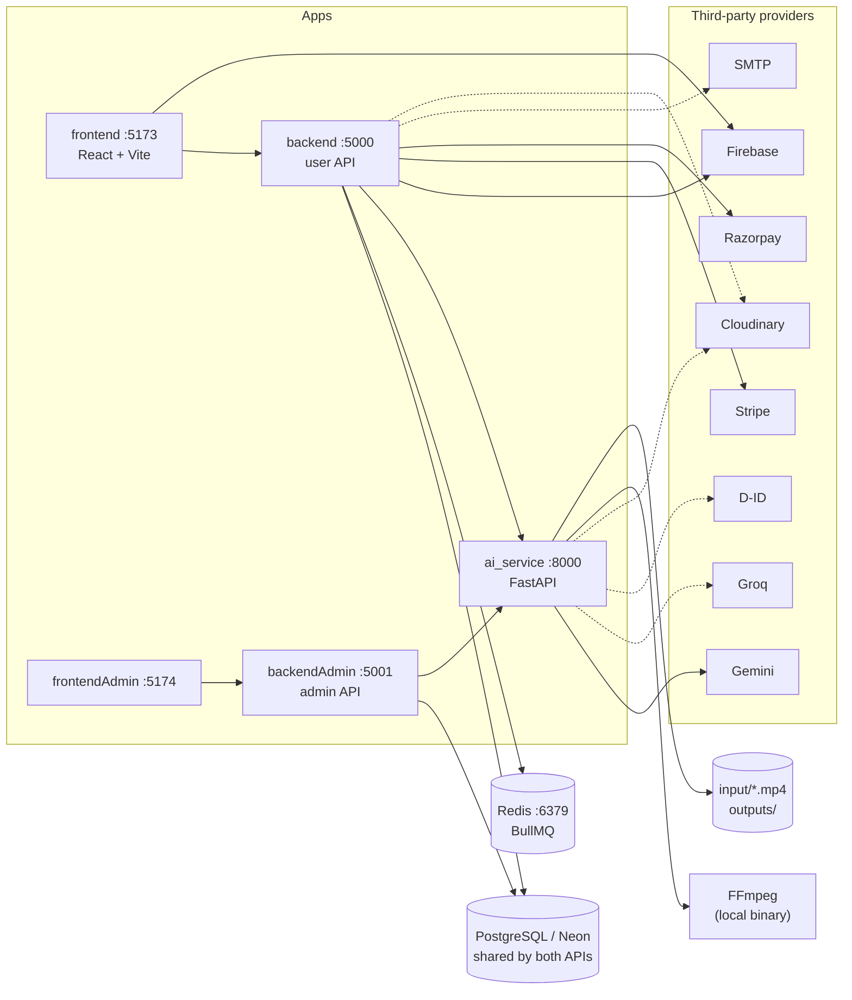

# External Dependency Model and Local Development Failure Boundaries

> Research document. It describes what the repository's documentation and verified code
> reading say about the external systems the local stack depends on, and what happens when one
> is missing. It does not prescribe changes. Closes #548.
>
> **Evidence base and limits.** Sources are the root `README.md`, `initalSetup.md`,
> `backend/README.md` and `ai_service/README.md` on `main`, plus code-level findings from
> `docs/AI_LESSON_GENERATION_FLOW.md` (written against commit `817b3e8`, #530). The setup and
> runner scripts under `scripts/` and the `.env.example` files were **not** read directly for
> this document. Every row below is tagged with where its claim comes from:
>
> - **[doc]**: stated in repository documentation.
> - **[code]**: confirmed by reading code in the #530 work.
> - **[tested]**: documentation states it was verified by running the stack.
> - **[open]**: not established by the sources; listed in section 7.

## Contents

1. [Runtime topology](#1-runtime-topology)
2. [Dependency tiers](#2-dependency-tiers)
3. [Required vs optional matrix: external systems](#3-required-vs-optional-matrix-external-systems)
4. [Required vs optional matrix: configuration values](#4-required-vs-optional-matrix-configuration-values)
5. [Failure boundaries](#5-failure-boundaries)
6. [Partial configuration behavior](#6-partial-configuration-behavior)
7. [Documentation inconsistencies and open questions](#7-documentation-inconsistencies-and-open-questions)
8. [Sources](#8-sources)

---

## 1. Runtime topology

Five applications run together, backed by shared stores and third-party services.

Solid arrows are dependencies the documentation treats as required for the path they serve.
Dashed arrows are optional or feature-specific.

Two structural facts shape the failure model:

- **One database, two writers, one schema owner.** `backend` and `backendAdmin` use the same
  database. `backend` creates and alters tables on startup (`sequelize.sync({ alter: true })`);
  `backendAdmin` does not. [doc]
- **Each Node service validates its own `.env` independently.** There is no shared config
  file. Five `.env` files exist (`backend`, `frontend`, `backendAdmin`, `frontendAdmin`,
  `ai_service/backend`). Some values must agree across files (section 6). [doc]

---

## 2. Dependency tiers

What the stack needs depends on which part of the product is being used.

| Tier | Capability | What must be present |
|---|---|---|
| **0. Tooling** | Install and lint | Node.js 18+, npm, Git. Python 3.10+ if the AI service is set up. [doc] |
| **1. User API** | `backend` boots and serves requests | PostgreSQL (or Neon), plus five variables: `NEON_DATABASE_URL`, `JWT_SECRET`, `STRIPE_SECRET_KEY`, `RAZORPAY_KEY_ID`, `RAZORPAY_KEY_SECRET`. [doc, tested] |
| **2. Learner UI** | `frontend` dev server boots | Tier 1 reachable at `VITE_API_BASE_URL`, plus seven mandatory `VITE_` values (API URL and six Firebase values). [doc] |
| **3. Admin** | `backendAdmin` and `frontendAdmin` | Tier 1's database (same URL and JWT secret), `SUPER_ADMIN_*` values for seeding, and `backend` started first so tables exist. [doc] |
| **4. AI lessons** | Generate a narrated lesson video | AI service running, `GEMINI_API_KEY`, FFmpeg, Redis on port 6379, `input/modi.mp4` (and the other stock videos for those voices). [doc, code] |
| **5. Feature extras** | Specific features only | Firebase Admin (Google login), SMTP (password reset), Cloudinary, Stripe webhook secret, Groq, D-ID. [doc] |

Tiers 1 and 2 are the minimum to see the learner application. A notable property of Tier 1 is
that both payment providers are required to start the API **even when payments are never used**.
[tested]

---

## 3. Required vs optional matrix: external systems

| System | Used by | Classification | If absent | Source |
|---|---|---|---|---|
| **PostgreSQL** (local 14+ or Neon) | `backend`, `backendAdmin` | **Required** for both APIs | Connection error at startup (`SequelizeConnectionRefusedError`); `/health/ready` reports not ready | [doc] |
| **Redis** (Memurai on Windows) on `127.0.0.1:6379` | `backend` (BullMQ video queue) | **Required for AI lesson generation only** | Setup prints a warning; video jobs stay queued and never run. Whether the user API itself still boots is not documented | [doc, code], [open] |
| **FFmpeg** | `ai_service` | **Required for local video rendering** | `npm run setup` / `setup:ai` fails with `FFmpeg not found`; without a binary the FFmpeg fallback renderer cannot run | [doc] |
| **Gemini** (`GEMINI_API_KEY`) | `ai_service` | **Required** for AI features | Setup stops with an explicit error; service cannot generate scripts or syllabi | [doc] |
| **Stripe** | `backend` | **Required to boot** (secret key) | Process exits at startup: `Missing STRIPE_SECRET_KEY environment variable` | [tested] |
| **Razorpay** | `backend` | **Required to boot** (key ID and secret) | Process exits at startup: `Missing Razorpay environment variables` | [tested] |
| **Firebase** (web config) | `frontend` | **Required to boot** the dev server | Vite refuses to start; `Environment Variable Error — Frontend` | [doc] |
| **Firebase Admin** | `backend` | Optional (feature) | Server starts; Google login does not work | [doc] |
| **Cloudinary** | `backend` | Optional (feature) | Server starts; image and video uploads do not work | [doc] |
| **Cloudinary** | `ai_service` | Optional, **as a complete set of three** | Cloud delivery disabled; video stays on local disk and is served through the user API proxy | [doc, code] |
| **Groq** | `ai_service` | Optional | Syllabus fallback disabled; Gemini remains | [doc] |
| **D-ID** | `ai_service` | Optional | D-ID rendering skipped; FFmpeg fallback renderer used | [doc, code] |
| **SMTP** | `backend` | Optional (feature) | Server starts; password-reset email does not work | [doc] |
| **Stripe webhook secret** | `backend` | Optional (feature) | Server starts; webhooks do not work | [doc] |
| **Stock input videos** (`ai_service/backend/input/*.mp4`) | `ai_service` | **Required files**; `modi.mp4` is the documented default | Requested celebrity file missing falls back to `modi.mp4`; if that is also missing, jobs stay `processing` per the troubleshooting guidance | [doc] |
| **Local `outputs/` directory** | `ai_service` | Auto-created, git-ignored | n/a | [doc] |

---

## 4. Required vs optional matrix: configuration values

### 4.1 `backend/.env`

| Variable(s) | Required? | Effect when missing |
|---|---|---|
| `NEON_DATABASE_URL` (or the local `DB_*` set with this left empty) | **Required** | No database connection; startup failure |
| `JWT_SECRET` | **Required** | Startup failure per setup docs |
| `STRIPE_SECRET_KEY` | **Required** | Process exits at startup [tested] |
| `RAZORPAY_KEY_ID`, `RAZORPAY_KEY_SECRET` | **Required** | Process exits at startup [tested] |
| `AI_SERVICE_URL` | Defaulted (`http://127.0.0.1:8000`) | Wrong or unreachable value breaks AI generation only |
| `FRONTEND_URL` | Defaulted (`http://localhost:5173`) | Mismatch with the browser origin gives `Not allowed by CORS` |
| `REDIS_HOST`, `REDIS_PORT` | Defaulted (`127.0.0.1:6379`) | Queue connection fails; AI jobs never run [code] |
| `CLOUDINARY_*` | Feature | Uploads fail |
| `SMTP_*`, `FROM_EMAIL`, `FROM_NAME` | Feature | Password-reset email fails |
| `FIREBASE_PROJECT_ID`, `FIREBASE_CLIENT_EMAIL`, `FIREBASE_PRIVATE_KEY` | Feature | Google login fails |
| `STRIPE_WEBHOOK_SECRET` | Feature | Webhooks fail |

### 4.2 `frontend/.env`

| Variable(s) | Required? | Effect when missing |
|---|---|---|
| `VITE_API_BASE_URL` and the six `VITE_FIREBASE_*` values | **Required (seven)** | Vite refuses to start; also rejected if still a `your_...` placeholder |
| `VITE_STRIPE_PUBLISHABLE_KEY`, `VITE_RAZORPAY_KEY_ID` | Not in the mandatory seven | Documented as part of the file; behavior when absent is not stated [open] |

### 4.3 `backendAdmin/.env` and `frontendAdmin/.env`

| Variable(s) | Required? | Effect when missing |
|---|---|---|
| `NEON_DATABASE_URL` (same as `backend`) | **Required** | No database connection |
| `JWT_SECRET` (same as `backend`) | **Required**, must match | Documented as "use the same value"; the consequence of a mismatch is not stated [open] |
| `SUPER_ADMIN_NAME`, `_EMAIL`, `_PASSWORD` | Required only for `seed:superadmin` | No admin account can be created, so admin login is impossible |
| `FRONTEND_ADMIN_URL`, `AI_SERVICE_URL`, `PORT` | Defaulted | CORS or AI proxy failures if wrong |
| `frontendAdmin`: `VITE_API_BASE_URL` | Required, must be `:5001` | Pointing at `:5000` loads the shell but every page is empty |

### 4.4 `ai_service/backend/.env`

| Variable(s) | Required? | Effect when missing |
|---|---|---|
| (the file itself) | **Required** | Setup stops: `Missing AI environment file` |
| `GEMINI_API_KEY` | **Required** | Setup stops; placeholder values are rejected |
| `GEMINI_MODEL`, `LLM_TIMEOUT_SECONDS` | Defaulted | n/a [code] |
| `GROQ_API_KEY` | Optional | Fallback provider disabled |
| `CLOUDINARY_CLOUD_NAME`, `_API_KEY`, `_API_SECRET` | Optional **as a set** | Any missing value disables cloud delivery; local fallback applies |
| `DID_API_KEY`, `DID_SOURCE_URL`, `DID_API_URL` | Optional | FFmpeg fallback renderer applies |

---

## 5. Failure boundaries

A failure boundary is the point where a missing dependency is first detected and how far the
effect spreads. Four kinds occur in this repository.

| Kind | Meaning |
|---|---|
| **Setup-time stop** | `npm run setup` or `setup:ai` exits with an explicit message before anything runs |
| **Boot-time crash** | The service process exits on start |
| **Request-time failure** | The service runs; the dependent feature fails when used |
| **Silent stall** | Nothing errors; work simply does not progress |

| Missing dependency | Boundary | Blast radius | How it surfaces |
|---|---|---|---|
| Node, npm, Python, FFmpeg | Setup-time stop | Whole setup, or AI setup | Named error from the setup script [doc] |
| `ai_service/backend/.env` or `GEMINI_API_KEY` | Setup-time stop | AI service | Names the file or variable; values never printed [doc] |
| Redis | **Setup-time warning, then silent stall** | AI lesson generation only | Warning at setup; at runtime, jobs remain queued and the learner's poll eventually times out [doc, code] |
| PostgreSQL unreachable | Boot-time failure | Both APIs, and therefore all four web and admin surfaces | `SequelizeConnectionRefusedError`; `/health/ready` not ready [doc] |
| `STRIPE_SECRET_KEY` or Razorpay keys | Boot-time crash | User API, and therefore the learner app | Exit message names the variable [tested] |
| Any of the seven mandatory `VITE_` values | Boot-time crash | Learner app only | Vite exits with an environment error [doc] |
| `backend` not started before `backendAdmin` on an empty database | Request-time failure | Admin API | Tables do not exist yet; ordering is the stated mitigation [doc] |
| `FRONTEND_URL` mismatched | Request-time failure | Browser calls to the user API | `Not allowed by CORS` [doc] |
| `frontendAdmin` API URL wrong | Request-time failure | Admin UI | Loads, but all pages empty [doc] |
| Firebase Admin values | Request-time failure | Google login only | Login "does nothing" [doc] |
| SMTP values | Request-time failure | Password reset only | Email not sent [doc] |
| Gemini unreachable or rate limited (key present) | Request-time failure | AI generation | Job ends `failed`; behavior beyond that depends on retry settings [code] |
| Cloudinary values absent in `ai_service` | **Graceful degradation** | Media delivery path | Local file plus user API proxy; see caveat 4 in the #530 document for the fragility of that path [code] |
| D-ID values absent | **Graceful degradation** | Renderer choice | FFmpeg fallback renderer [code] |
| Groq key absent | **Graceful degradation** | Syllabus fallback only | Gemini only [doc] |
| `input/modi.mp4` absent | Silent stall | Every AI voice that falls back to it | Job remains `processing`; troubleshooting points to the missing file [doc] |
| AI service restarted mid-job | Silent stall | In-flight jobs | In-memory job state lost; status returns `not_found`; the database row can remain `processing` [code] |
| AI service not running | Request-time failure | AI lessons only | User API returns a sanitized error; provider detail stays in server logs [doc] |

### Observations on the shape of the model

1. **Required-to-boot and required-to-use differ.** Payments are required to boot but not to
   use. Redis, Firebase Admin, SMTP and Cloudinary are the opposite: not required to boot,
   required for their feature.
2. **Detection is front-loaded for the AI service and back-loaded for everything else.** The AI
   setup path validates imports, FFmpeg, configuration names and Redis before runtime. The
   Node services mostly learn about a missing dependency at start or at first use.
3. **The only silent stalls are on the AI path.** Redis, the stock videos, and AI service
   restarts all produce "still processing" rather than an error.
4. **The database is the single point whose loss takes down every web surface.** Both APIs
   share it; the admin and learner applications each depend on their own API.
5. **Graceful degradation exists only for AI media and providers.** There is no documented
   fallback for the database, queue, or payment provider.

---

## 6. Partial configuration behavior

| Situation | Documented behavior |
|---|---|
| Cloudinary set partially (one or two of three) in `ai_service` | Treated as not configured; cloud delivery disabled and local fallback used. Older troubleshooting text instead says all three must be set (see section 7) |
| `DID_API_KEY` set without `DID_SOURCE_URL` | Not documented [open] |
| `NEON_DATABASE_URL` and local `DB_*` both set | Documented rule: for local PostgreSQL, leave `NEON_DATABASE_URL` empty. Precedence when both are set is not documented [open] |
| `JWT_SECRET` differs between `backend` and `backendAdmin` | Documented as must-match; effect not documented [open] |
| Firebase web keys set, Firebase Admin values missing | Learner UI boots; Google login fails at the server |
| Payment keys present but fake test values | Satisfies the boot check [tested]; Stripe webhooks and real payment flows remain unconfigured |
| `FIREBASE_PRIVATE_KEY` pasted without literal `\n` | Google login fails [doc] |
| Placeholder (`your_...`) values | Rejected for mandatory `VITE_` values and for `GEMINI_API_KEY`; other variables not documented as checked |
| CI | Uses dummy frontend and AI-service values; they are sufficient for build and test jobs, which is a narrower claim than "sufficient for local development" |

Values that must agree across files:

| Pair | Must match |
|---|---|
| `backend` and `backendAdmin` | `NEON_DATABASE_URL`, `JWT_SECRET` |
| `backend` `FRONTEND_URL` and learner browser origin | `http://localhost:5173` |
| `frontendAdmin` `VITE_API_BASE_URL` and admin API port | `http://localhost:5001` |
| `backend` and `backendAdmin` `AI_SERVICE_URL` and AI service address | `http://127.0.0.1:8000` |
| `frontend` `VITE_RAZORPAY_KEY_ID` and `backend` `RAZORPAY_KEY_ID` | Same value |

---

## 7. Documentation inconsistencies and open questions

### Inconsistencies observed between documents

1. **Cloudinary in the AI service.** `README.md` and `initalSetup.md` call it optional with a
   local fallback. The `initalSetup.md` troubleshooting table and the `ai_service/README.md`
   troubleshooting table still describe `Cloudinary credentials missing` as an error whose fix
   is to set all three. Likewise `GROQ_API_KEY not found` is listed as an error although Groq is
   described as optional.
2. **Database variable name.** `backend/README.md` says the project expects the connection
   string in `DATABASE_URL`, while its own example and `initalSetup.md` use `NEON_DATABASE_URL`.
3. **TTS engine.** `ai_service/README.md` describes `pyttsx3` (offline); the pipeline reviewed in
   #530 used `edge-tts` (online). If the latter is current, text-to-speech is itself an external
   network dependency that the setup documents do not list.
4. **Express version.** Root `README.md` lists Express 5; `backend/README.md` lists Express 4.
5. **Startup commands.** The root `README.md` and `initalSetup.md` describe `npm run dev` and
   `npm run dev:ai`. `ai_service/README.md` still shows manual `venv` and `uvicorn` steps and a
   `venv` directory, while setup creates `ai_service/.venv`.
6. **Runtime versions.** Prerequisites state Node 18+ and Python 3.10+; CI uses Node 20 and
   Python 3.11. Whether 18 and 3.10 are exercised anywhere is not shown.

### Open questions (not established by the sources read)

1. Does the user API boot when Redis is down, and what does the first enqueue do?
2. Does the user API fail at boot or at first use when `NEON_DATABASE_URL` is empty and `DB_*`
   values are also absent?
3. What is the effect of mismatched `JWT_SECRET` values across the two APIs?
4. Is `edge-tts` an active dependency, and is any other outbound network service used by the AI
   pipeline?
5. What does `/health/ready` check beyond the database? Does it cover Redis or the AI service?
6. Which of the `.env.example` entries are read by code but not documented (and vice versa)?
7. Behavior of `VITE_STRIPE_PUBLISHABLE_KEY` and `VITE_RAZORPAY_KEY_ID` when missing.

Answering 1, 2 and 5 requires reading `backend/server.js`, `backend/config/db.js`, the health
routes and `queues/videoQueue.js`; answering 4 requires `ai_service/backend/requirements.txt`
and `voices.py`; and 3 requires the admin auth middleware. These were outside the sources used
for this document.

---

## 8. Sources

| Source | Used for |
|---|---|
| `README.md` | Topology, ports, prerequisites, environment groups, optional versus required AI configuration, CI behavior |
| `initalSetup.md` | Required variables per service, verified startup crashes, setup order, troubleshooting messages, health endpoints |
| `backend/README.md` | Database sync behavior, Redis note, AI route caching |
| `ai_service/README.md` | Input videos, output directories, pipeline, older troubleshooting text |
| `docs/AI_LESSON_GENERATION_FLOW.md` (#530) | Code-level facts about Redis, BullMQ, renderers, Cloudinary fallback and in-memory job state, at commit `817b3e8` |
