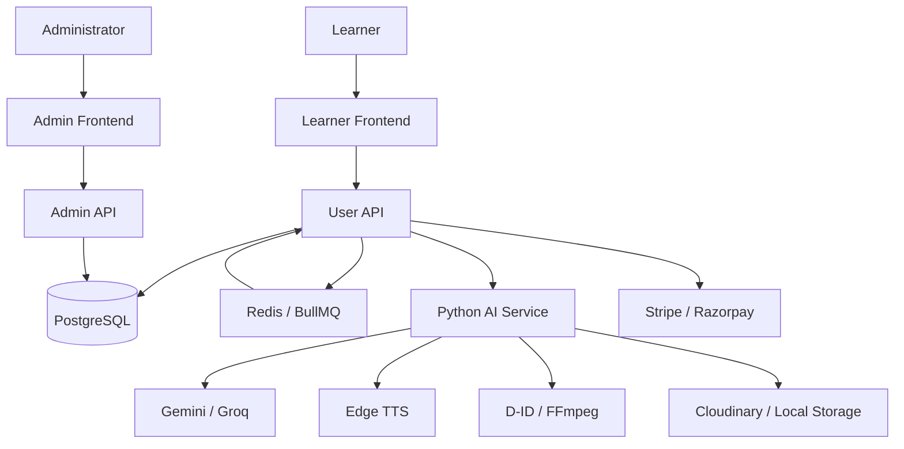
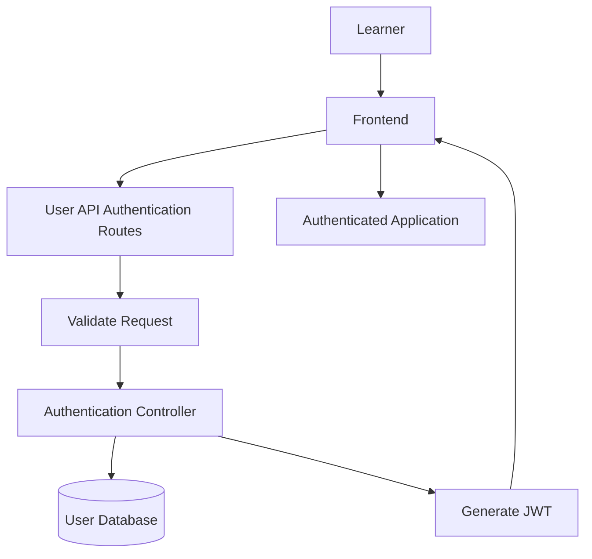
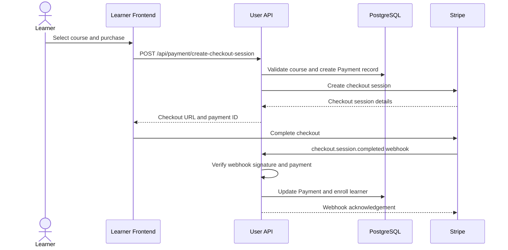
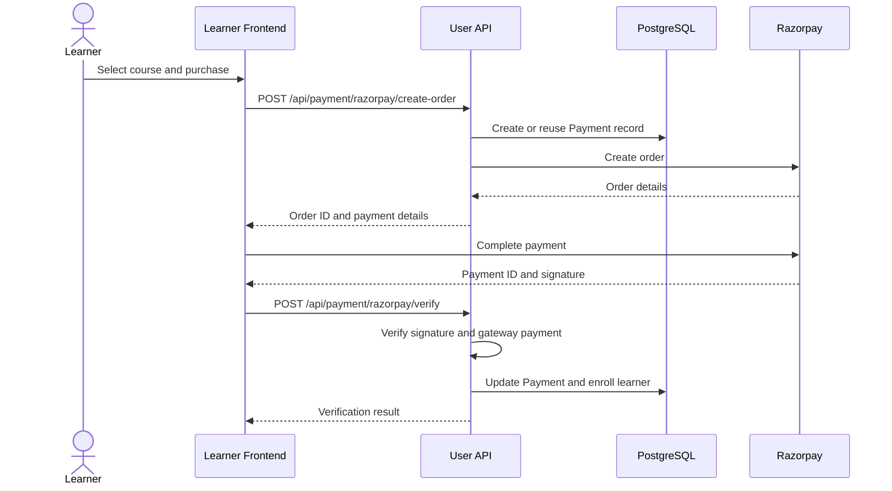
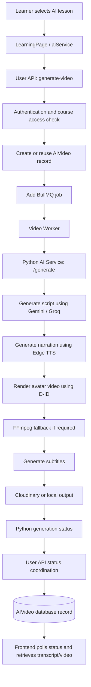
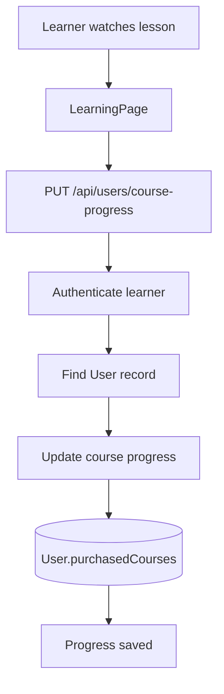

# Product Flow and System Architecture

## 1. Purpose

This document explains the main learner journeys and service responsibilities in the Ai_Mentor platform.

It covers:
- Authentication
- Course discovery and purchase
- Payment verification and enrollment
- AI-augmented lesson generation
- Lesson progress and completion
- Service ownership and external integrations

This is an architecture and onboarding reference. It does not describe implementation changes.

## 2. System Overview

Ai_Mentor consists of five main components:

| Component | Location | Responsibility |
|---|---|---|
| Learner Frontend | `frontend/` | Learner-facing UI and API requests |
| User API | `backend/` | Authentication, courses, payments, enrollment, learner progress and AI coordination |
| Admin Frontend | `frontendAdmin/` | Administrative interface |
| Admin API | `backendAdmin/` | Platform administration and management |
| AI Service | `ai_service/backend/` | AI content, lesson scripts, narration and video generation |

### High-level architecture

The learner and admin applications use separate APIs. Both backend applications use PostgreSQL. The User API also coordinates background AI video-generation jobs.

## 3. Authentication Flow

### Main endpoints

| Endpoint | Purpose |
|---|---|
| `POST /api/auth/register` | Register a new learner |
| `POST /api/auth/login` | Email/password login |
| `POST /api/auth/google-login` | Google login |
| `POST /api/auth/forgot-password` | Request password reset |
| `POST /api/auth/reset-password/:token` | Reset password |

### Flow

### Responsibilities

- The frontend submits authentication requests.
- User API routes apply validation and rate limiting.
- Authentication controllers handle registration and login.
- User records are created or retrieved from the database.
- JWT tokens are generated for authenticated sessions.
- Google authentication verifies Firebase ID tokens.
- Password reset uses hashed reset tokens and expiration.

Authentication is owned by the User API.

## 4. Course Discovery and Purchase

### Course discovery

| Endpoint | Purpose |
|---|---|
| `GET /api/courses` | List available courses |
| `GET /api/courses/:id` | Get course details |
| `GET /api/courses/my-courses` | List learner's purchased courses |
| `GET /api/courses/:id/learning` | Get learning data |

The User API handles learner-facing course discovery and learning access.

### Stripe purchase flow

Important details:

- The User API checks that the course exists and is published.
- It creates or updates a Payment record.
- Stripe checkout session creation is handled through `paymentGatewayServices`.
- Stripe webhook signature is verified.
- The backend checks payment, course, amount and currency details.
- Successful payment updates the Payment record and enrolls the learner.
- Enrollment is idempotent to avoid duplicate course entries.

### Razorpay purchase flow

Razorpay verification checks the signature and, where configured, fetches payment details from the gateway to validate status, amount, currency and order ID.

### Stripe vs Razorpay

| Aspect | Stripe | Razorpay |
|---|---|---|
| Payment initiation | Checkout session | Order creation |
| Verification | Webhook signature and event validation | Signature and gateway payment verification |
| Enrollment trigger | Successful webhook processing | Successful `/verify` request |
| Payment persistence | Payment model | Payment model |

## 5. Enrollment and Course Access

After successful payment verification:

1. The backend updates the Payment record.
2. It identifies the learner and purchased course.
3. The course is added to `User.purchasedCourses`.
4. Initial progress is created with an empty `completedLessons` list and `currentLesson` set to `null`.
5. The learner can access purchased course learning data.

The User API checks purchased-course access before allowing protected learning and AI video operations.

## 6. AI-Augmented Lesson Generation

### Main endpoints

| Endpoint | Purpose |
|---|---|
| `POST /api/ai/generate-video` | Request AI video generation |
| `GET /api/ai/status/:jobId` | Check generation status |
| `GET /api/ai/transcript/:filename` | Retrieve lesson transcript |

### End-to-end generation flow

### Service responsibilities

**Learner Frontend**
- Sends the generation request.
- Provides authentication headers.
- Accepts a cached video response or a new job ID.
- Polls the status endpoint.
- Retrieves the transcript.

**User API**
- Checks authentication and course access.
- Creates or reuses an `AIVideo` record.
- Avoids duplicate in-progress generation jobs.
- Queues work through BullMQ.
- Coordinates with the Python AI service.
- Persists generated video and transcript metadata.

**BullMQ worker**
- Processes queued video-generation jobs.
- Sends course title, lesson title, celebrity and user preferences to the Python `/generate` endpoint.
- Saves the Python job ID and transcript filename in the AIVideo record.

**Python AI service**
- Generates lesson scripts using Gemini with Groq fallback.
- Generates narration using Edge TTS.
- Attempts avatar rendering using D-ID.
- Uses FFmpeg as a fallback.
- Generates subtitles.
- Uploads generated media to Cloudinary or retains local output when upload fails.

The Python service exposes status and transcript endpoints. The User API coordinates frontend access to those results.

## 7. Lesson Progress and Completion

### Endpoint

`PUT /api/users/course-progress`

The frontend calls this endpoint from `LearningPage.jsx`.

### Progress flow

The `updateCourseProgress` controller maintains:

| Field | Purpose |
|---|---|
| `lessonData` | Lesson-specific information |
| `currentLesson` | Current learning position |
| `completedLessons` | Completed lesson records |

Progress is stored inside the learner's `purchasedCourses` data in the User model.

Completed lessons are checked before insertion to avoid duplicate entries.

**Important:** AI video generation and lesson completion are separate operations. A generated video becoming ready does not itself establish that the learner completed the lesson.

## 8. Service Ownership Matrix

| Service | Owns | Main responsibilities |
|---|---|---|
| Learner Frontend | Learner UI | Authentication forms, course browsing, purchase initiation, learning experience, AI generation requests and progress updates |
| User API | Learner-facing business logic | Authentication, course discovery, payments, enrollment, access control, progress persistence and AI job coordination |
| Admin Frontend | Admin UI | Administrative workflows |
| Admin API | Platform management | Admin authentication, course and user management, enrollment/payment overview, reports, notifications and moderation |
| Python AI Service | AI generation | Lesson scripts, narration, avatar/video generation, subtitles, quizzes, flashcards and code explanations |

### Admin API routes

Admin API is mounted at `/api/admin`.

Its responsibilities include:

- Admin authentication and profile management.
- Course creation, status updates and deletion.
- Course syllabus viewing and generation.
- User management.
- Enrollment and payment overview.
- Reports and discussion moderation.
- Admin notifications and admin management.

Sensitive operations use `protectAdmin` and, where required, `superAdminOnly`.

## 9. Data Ownership and External Integrations

| Component | Purpose |
|---|---|
| PostgreSQL | Persistent application data |
| User model | Learner details and purchased course progress |
| Payment model | Payment lifecycle and gateway references |
| AIVideo model | AI video job and output metadata |
| Redis | BullMQ queue infrastructure |
| BullMQ | Background AI video job processing |
| Stripe | Checkout and payment event delivery |
| Razorpay | Order creation and payment verification |
| Firebase | Google authentication verification |
| Gemini / Groq | AI text generation |
| Edge TTS | Narration generation |
| D-ID | Avatar video rendering |
| FFmpeg | Media processing and fallback video generation |
| Cloudinary | Generated media storage |

The Python AI service also maintains generation status in an in-memory TTL cache. This is distinct from the persistent AIVideo records maintained by the User API.

## 10. Important Architecture Notes

1. Learner-facing operations are handled by the User API, while platform administration is handled by the Admin API.
2. Payment initiation and enrollment are separate stages. Enrollment follows successful payment verification.
3. Stripe and Razorpay use different payment verification mechanisms.
4. Course access is checked before protected AI video generation.
5. BullMQ moves long-running video generation work out of the initial learner request.
6. The Python AI service performs actual media generation; the User API coordinates access, jobs and persistence.
7. AI video readiness and learner lesson completion are separate states.
8. Learner course progress is stored in `User.purchasedCourses`.

## 11. Scope and Verification Notes

This document describes the main paths traced in the repository. It focuses on successful learner journeys and the main service boundaries.

The following implementation details were not exhaustively traced in this research:
- Every frontend payment-screen interaction.
- Every admin controller's internal business logic.
- Every AI-generation failure and retry scenario.
- Every payment-gateway edge case.

These are outside the core purpose of this onboarding-oriented flow map.